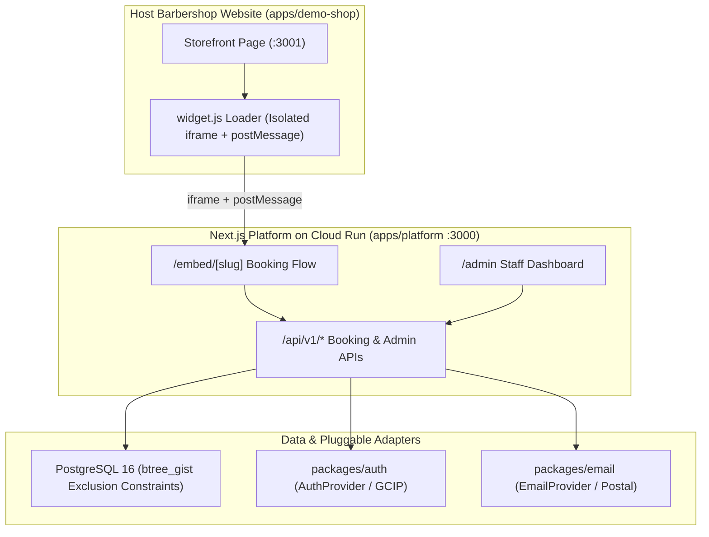

# Bespoke Bookings

An ultra-low-cost, multi-tenant booking engine and staff management platform built for independent barbershops.

> **Portfolio & Reference Implementation:** This repository is a public portfolio showcase provided as-is. It ships with a fictional demo barbershop — **Crown & Blade Barbers** (Soho & Shoreditch branches, `crownandblade.example`) — and local in-memory/demo adapters so the full booking widget, embeddable storefront, and admin dashboard run locally with zero external cloud setup.

Bespoke Bookings replaces high-commission marketplace platforms by embedding directly inside a barbershop's existing website via an isolated iframe loader, giving barbers 100% customer ownership and zero per-booking commission.

---

## System Architecture



### Technology Stack

| Layer | Technology | Rationale |
|---|---|---|
| **Frontend & APIs** | Next.js (App Router) + TypeScript | Embeddable booking flow, staff admin dashboard, and shared REST APIs |
| **Embed Loader** | Vanilla JS (`apps/widget`) + Isolated `iframe` | Prevents host website CSS/JS conflicts; communicates via `window.postMessage` |
| **Container Runtime** | Google Cloud Run (`Dockerfile` + `cloudbuild.yaml`) | Scales to zero when idle; generous free tier |
| **Database** | PostgreSQL 16 (`packages/database`) | Relational multi-tenancy with `btree_gist` exclusion constraints |
| **Auth** | Pluggable `AuthProvider` (`packages/auth`) | Local `DemoAuthProvider` + Google Cloud Identity Platform (`GCIPAuthProvider`) contract |
| **Email** | Pluggable `EmailProvider` (`packages/email`) | Local `DemoEmailProvider` + self-hosted [Postal](https://github.com/postalserver/postal) (`PostalClient`) |

---

## Monorepo Layout

```text
bespoke-bookings/
├── apps/
│   ├── platform/          # Core Next.js service (:3000): /embed/[slug], /admin, /api/v1/*
│   ├── demo-shop/         # Fictional Crown & Blade Barbers storefront (:3001) embedding widget.js
│   └── widget/            # Standalone vanilla JS iframe embed loader
├── packages/
│   ├── auth/              # Pluggable AuthProvider (DemoAuthProvider & GCIPAuthProvider)
│   ├── database/          # PostgreSQL 16 DDL (btree_gist), in-memory demo store & scheduling engine
│   ├── email/             # Pluggable EmailProvider (DemoEmailProvider & PostalClient)
│   ├── types/             # Shared TypeScript DTOs & domain types
│   └── ui/                # Shared UI components
├── docs/                  # Product vision, architecture specs & ADRs
├── .github/workflows/     # GitHub Actions CI (typecheck, lint, test, build)
└── cloudbuild.yaml        # Google Cloud Build CI/CD pipeline for Cloud Run
```

---

## Local Quick-Start

### Prerequisites

- **Node.js** `>= 22`
- **pnpm** `10.x` (`corepack enable` or `npm i -g pnpm`)

### Run Locally

```bash
# 1. Install workspace dependencies
pnpm install

# 2. Start all apps in development mode
pnpm dev
```

Once running:

- **Booking Platform & Admin Dashboard:** `http://localhost:3000`
  - Embedded booking flow (Soho): `http://localhost:3000/embed/soho`
  - Embedded booking flow (Shoreditch): `http://localhost:3000/embed/shoreditch`
  - Staff admin dashboard: `http://localhost:3000/admin`
- **Demo Barbershop Storefront (Crown & Blade Barbers):** `http://localhost:3001`

### Verification Commands

```bash
pnpm check-types   # Strict TypeScript checks across all workspaces
pnpm lint          # ESLint across apps
pnpm test          # Unit & scheduling concurrency tests
pnpm build         # Production builds for all apps and packages
```

---

## Pluggable Adapters & Database Concurrency

### Pluggable Auth & Email Adapters

Both external infrastructure boundaries are isolated behind explicit interfaces so the repo runs locally without credentials while remaining ready for production GCP/Postal wiring:

- **[`packages/auth`](packages/auth/README.md):** Exports `AuthProvider`, `DemoAuthProvider` (local demo mode), and `GCIPAuthProvider` (fails fast with `GCIPConfigurationError` if `BESPOKE_AUTH_MODE=gcip` is enabled without GCP project ID and JWT verifier wiring).
- **[`packages/email`](packages/email/README.md):** Exports `EmailProvider`, `DemoEmailProvider` (in-memory message capture with deterministic IDs), and `PostalClient` (dispatches to Postal's `/api/v1/send/message` and `/api/v1/domains` endpoints when `POSTAL_API_URL` & `POSTAL_API_KEY` are set, falling back cleanly to demo mode when unconfigured).

### Database-Level Double-Booking Prevention (`btree_gist`)

Slot reservations are protected against race conditions at the PostgreSQL layer (`packages/database/src/schema.ts`) using the `btree_gist` extension and a range exclusion constraint:

```sql
CREATE EXTENSION IF NOT EXISTS btree_gist;

ALTER TABLE appointments
  ADD CONSTRAINT no_overlapping_appointments
  EXCLUDE USING gist (
    staff_id WITH =,
    tsrange(starts_at, ends_at, '[)') WITH &&
  )
  WHERE (status <> 'cancelled');
```

This guarantees that two concurrent booking requests for the same barber and overlapping time window can never both commit, regardless of application-tier concurrency.

---

## Documentation

- [Documentation Index](docs/README.md)
- [Product Vision & Commercial Strategy](docs/vision.md)
- [System Architecture & Technical Design](docs/architecture.md)
- [Initial Architecture Decision Record (ADR)](docs/adrs/20261010-InitialADR.md)

## License

[MIT](LICENSE)
