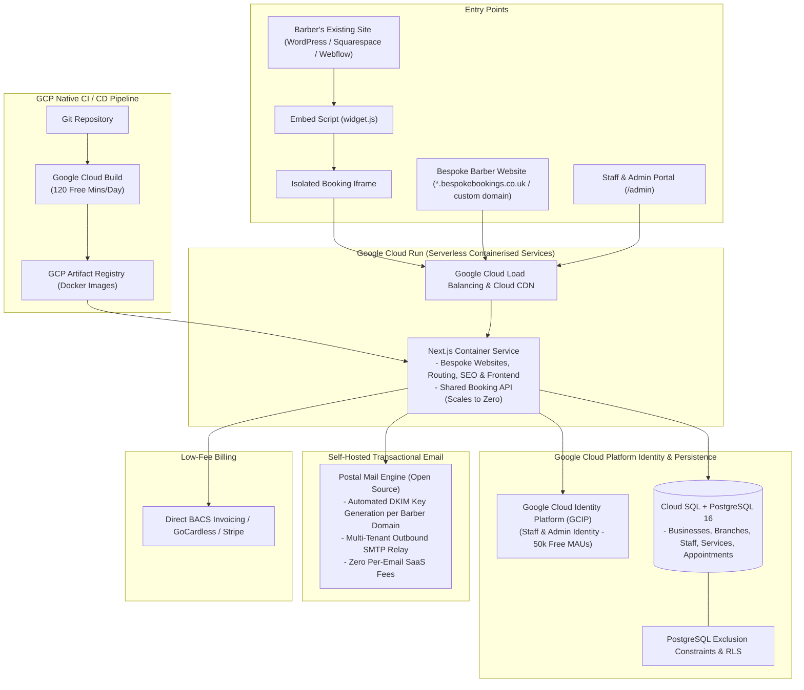
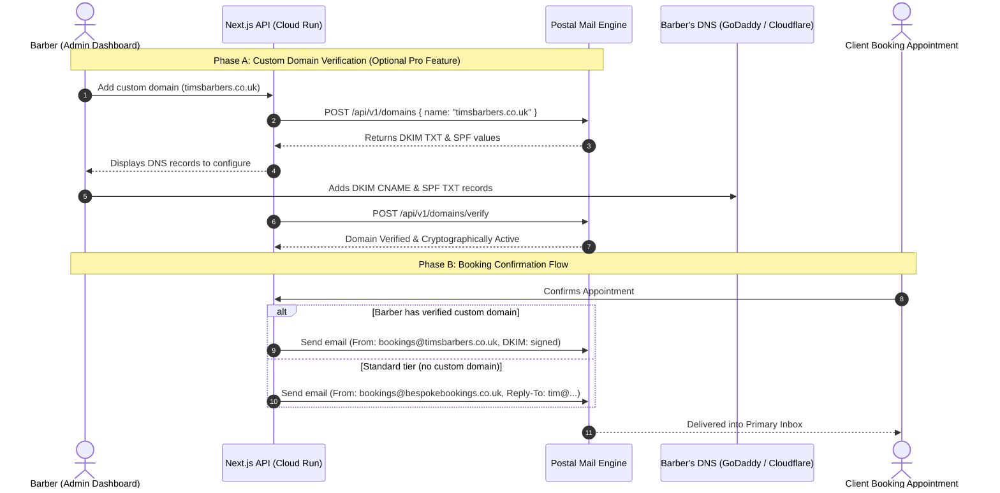
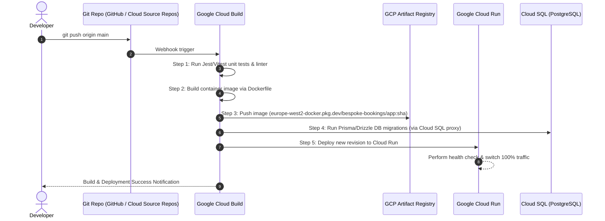

# System Architecture & Technical Design

## 1. High-Level Architecture

Bespoke Bookings is architected as an ultra-low-cost, high-margin, multi-tenant software-as-a-service (SaaS) built on **Google Cloud Platform (GCP)** and **open-source self-hosted infrastructure**. 

The design emphasizes:
* **Zero vendor tax:** Maximizing GCP free tiers and open-source self-hosted engines.
* **Separation of presentation and booking core:** Powers both embeddable widgets on existing sites (e.g., WordPress, Squarespace, Webflow) and standalone bespoke barber websites with custom routing and local SEO.
* **Open-Source Multi-Tenant Email (Postal):** Fully self-hosted transactional email engine capable of generating DKIM records dynamically for client-owned custom domains without requiring Google Workspace.



---

## 2. Core Stack Components & Roles

| Component | Technology | Role & Cost Strategy |
|---|---|---|
| **Frontend & Routing** | **Next.js + TypeScript** | Bespoke barber websites, dynamic subdomain routing, server-side rendering for local SEO, embeddable booking widget, and admin UI. Standard container image, £0 license cost. |
| **Container Runtime** | **Google Cloud Run** | Runs the websites and shared booking API as serverless containers. Scales to zero when idle; 2M requests/month free tier keeps runtime costs near £0 initially. |
| **Relational Database** | **Cloud SQL + PostgreSQL** | Manages relational data for businesses, branches, staff, services, and appointments with ACID guarantees and exclusion constraint protection. |
| **CI / CD Pipeline** | **Google Cloud Build** | Native GCP CI/CD. Runs automated tests, builds Docker containers, and deploys revisions to Cloud Run using native IAM service accounts (120 free build-minutes/day). |
| **Identity & Authentication** | **Google Cloud Identity Platform (GCIP)** | Enterprise identity management for staff and administrator login (when needed). Up to 50,000 monthly active users (MAUs) completely free. |
| **Transactional Email Engine** | **Postal (Open Source)** | Self-hosted mail delivery engine. Handles automated multi-tenant DKIM domain signing and outbound delivery without per-email SaaS markups. |
| **Billing & Payments** | **BACS / GoCardless / Stripe** | Low-fee strategy: direct BACS bank transfer for beta barbers (0% fee), scaling to GoCardless direct debit (1% fee) or Stripe. |

---

## 3. Self-Hosted Email Architecture (Postal)

Rather than paying monthly recurring subscription fees to third-party email providers (like Resend or Postmark) whose costs scale with message volume, Bespoke Bookings runs an instance of **[Postal](https://github.com/postalserver/postal)**—the leading open-source mail delivery platform.



### 3.1 Two Email Modes
1. **Default Mode (Zero DNS friction):**
   * `From: "Tim's Barbers" <bookings@bespokebookings.co.uk>`
   * `Reply-To: tim@timsbarbers.co.uk`
   * Perfect for solo barbers who don't want to manage DNS. Replies land directly in the barber's existing personal/shop inbox.
2. **Pro Custom Domain Mode (Fully White-Labeled):**
   * `From: "Tim's Barbers" <bookings@timsbarbers.co.uk>`
   * The barber enters their domain; Postal dynamically generates a unique 2048-bit DKIM keypair.
   * Once DNS verifies, Postal cryptographically signs outbound emails using Tim’s domain key.
   * **Tim does not need a Google Workspace account.**

---

## 4. Concurrency & Scheduling Safety

Preventing double bookings across chairs and staff is enforced directly by PostgreSQL on Cloud SQL using the `btree_gist` extension:

```sql
CREATE EXTENSION IF NOT EXISTS btree_gist;

ALTER TABLE appointments
ADD CONSTRAINT prevent_overlapping_staff_appointments
EXCLUDE USING gist (
  staff_id WITH =,
  tsrange(starts_at, ends_at) WITH &&
)
WHERE (status IN ('confirmed', 'pending_payment'));
```

### Why Database-Level Exclusion?
* Prevents race conditions when two customers simultaneously click "Confirm" on the same slot.
* Eliminates reliance on error-prone in-memory scheduling state across auto-scaling Cloud Run containers.
* Guarantees atomic transaction boundaries.

---

## 5. Embeddable Widget & Bespoke Sites

Bespoke Bookings supports two primary distribution modes:

1. **Embeddable Widget for Existing Sites (e.g. WordPress, Squarespace, Webflow):**
   * Barber places a lightweight script snippet on their site:
     ```html
     <div id="bespoke-booking" data-business="tonys-barbers"></div>
     <script src="https://assets.bespokebookings.co.uk/widget.js" async></script>
     ```
   * The script initializes an isolated `iframe` pointing to the Cloud Run service (`/embed/tonys-barbers`).
   * Uses `window.postMessage` for dynamic height auto-resizing, scroll position tracking, and booking completion callbacks.
   * Completely eliminates CSS collisions with the host website's theme.

2. **Bespoke Websites with Routing & SEO:**
   * Full-fledged websites rendered server-side by Next.js on Cloud Run.
   * Middleware inspects the incoming hostname/subdomain (e.g. `cutsbyjames.bespokebookings.co.uk` or `www.cutsbyjames.co.uk`) and rewrites requests to the appropriate business tenant.
   * Generates dynamic OpenGraph metadata, schema.org LocalBusiness JSON-LD, and semantic HTML for local search engine rankings.

---

## 6. Authentication Model (Google Cloud Identity Platform)

* **Staff & Administrator Login:** Google Cloud Identity Platform (GCIP) handles authentication for shop owners, managers, and staff barbers.
* **Server Verification:** Next.js API routes and Server Actions verify incoming GCIP JWT ID tokens via the `@google-cloud/identity-platform` SDK or Google Auth Library, extracting the verified `uid` and mapping it to the internal `staff` record.
* **Enterprise Multi-Tenancy (Optional):** GCIP supports project-level multi-tenancy natively, allowing isolated tenant user pools if bespoke corporate accounts require dedicated IDPs or SAML configurations in the future.
* **Frictionless Public Bookings:** End-customers booking an appointment **do not** require authentication. Customers simply provide name, phone number, and email.

---

## 7. GCP Native CI/CD Workflow (Cloud Build)


